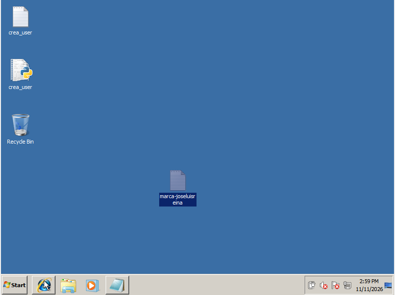
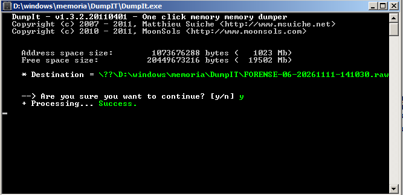
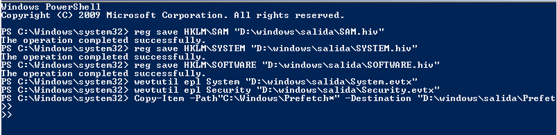
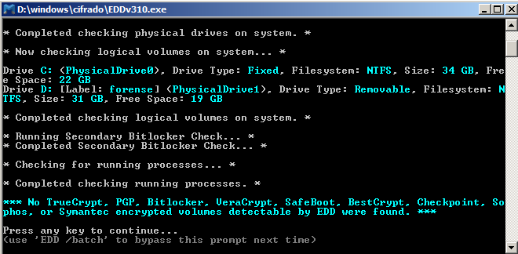
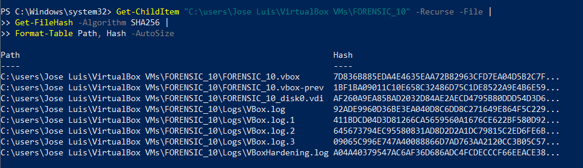
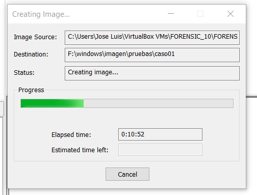
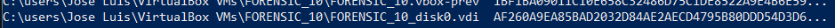
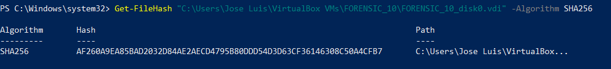
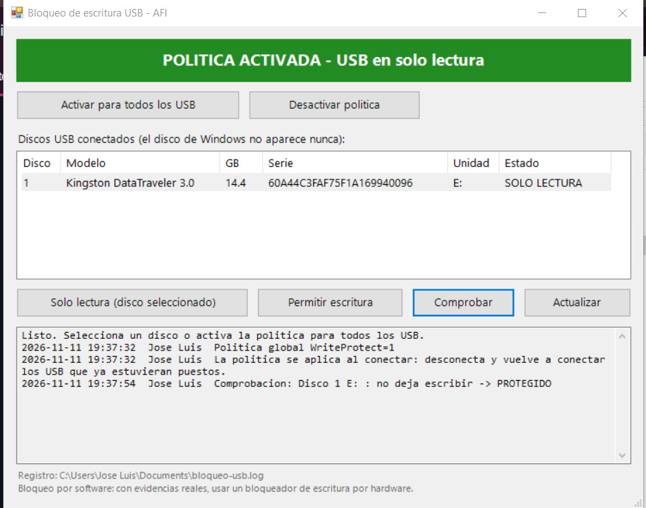
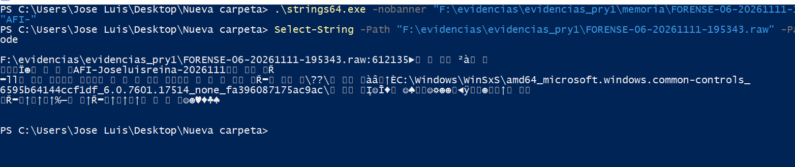

# Adquisición en Vivo

## Estado Inicial (11/11/2026 14:59):
La ordenador se encontró encendido a las 2:59 PM hora del sistema misma hora que la real.

## La memoria RAM (11/11/2026 15:16):
Usando DumpIT, genera esta ventana, automáticamente elige la ruta (donde este instalado) y el nombre del archivo destino. \
 \
El archivo .raw contiene los datos de la memoria RAM de la máquina virtual.

Tras varios intentos fallidos con comandos muy modernos para la versión de Windows usada como: \
`Get-FileHash "D:\windows\memoria\DumpIT\FORENSE-06-20261111-141030.raw" -Algorithm SHA256 | Out-File "D:\windows\memoria\DumpIT\FORENSE-06-20261111-141030.rawsha256"`

Por lo tanto, se acabó usando el siguiente comando que extraer el hash del archivo .raw: \
`certutil -hashfile "D:\windows\memoria\DumpIT\FORENSE-06-20261111-141030.raw" SHA256` \
con este comando podemos leer el hash del archivo en Windows 7.

## Los datos volátiles (11/11/2026 15:32):
No se han podido guardar los datos volátiles porque el script proporcionado no funcionaba, además he intentado modificarlo para que funcione en Windows 7 pero no llegaba a ejecutarse.

## El tráfico de red (11/11/2026 15:40): 
Para adquirir el tráfico de red de la máquina usamos estos comandos en orden:
Crear carpeta donde va a guardar la captura: \
``& "C:\Program Files\Oracle\VirtualBox\VBoxManage.exe" controlvm "FORENSIC_10" nictracefile1 "C:\Users\Jose Luis\Desktop\CASP-042\red.pcap"``

Iniciar la captura: \
``& "C:\Program Files\Oracle\VirtualBox\VBoxManage.exe" controlvm "FORENSIC_10" nictrace1 on``

Finalizar captura: \
``& "C:\Program Files\Oracle\VirtualBox\VBoxManage.exe" controlvm "FORENSIC_10" nictrace1 off``

Al terminar se genera red.pcap que puede ser leído a través de Wireshark.

## El triaje (11/11/2026 16:40):
Se intento usar KAPE para el triaje pero no funciona de manera correcta en Windows 7, por lo que optamos por esta serie de comandos para hacerlo a mano:

**Extraer colmenas del Registro: Usuarios, USBs y Sistema.**
`reg save HKLM\SAM "D:\salida\SAM.hiv"` \
`reg save HKLM\SYSTEM "D:\salida\SYSTEM.hiv"` \
`reg save HKLM\SOFTWARE "D:\salida\SOFTWARE.hiv"` \

**Extraer Visor de Eventos: Inicios de sesión y errores.** \
`wevtutil epl System "D:\salida\System.evtx"` \
`wevtutil epl Security "D:\salida\Security.evtx"`

**Extraer Prefetch: Rastro de programas ejecutados.** \
`Copy-Item -Path "C:\Windows\Prefetch*" -Destination "D:\salida\Prefetch" -Recurse`

**Captura:** \

## El cifrado (11/11/2026 16:57):
Para ver el cifrado, he usado la herramienta EDD desde el USB de respuesta: \

El programa identifica el disco del sistema (C:, NTFS de 34 GB) y tu USB de respuesta (D:, NTFS de 31 GB), y tras analizar procesos y discos. El programa muestra que no se encontró ningún volumen cifrado. 

## El apagado (11/11/2026 17:11):
Al finalizar se opta por cortar la luz o "tirar del cable" para apagar la máquina, como si fuera un caso real, ya que podría contener scripts de borrado al apagar u otras ejecuciones que beneficien a la perdida o modificación de los datos la máquina virtual.

## Incidencias:
Al trabajar en una versión de Windows tan desactualizada cuesta hacer uso de muchas de las herramientas actuales, la mayoría de estas hay que usar comandos desactualizados como el volcado de RAM o la incapacidad de usar KAPE. Tras mucha investigación he encontrado soluciones para casi todos los pasos dentro del proyecto para intentar que sea lo más completo posible.

# Adquisición Post-Mortem

## Disco de la máquina (11/11/2026 18:52):
Para calcular el hash de todos los archivos dentro de la máquina he usado estos comandos: \
`Get-ChildItem "C:\users\Jose Luis\VirtualBox VMs\FORENSIC_10" -Recurse -File |` \
`Get-FileHash -Algorithm SHA256 |` \
`Format-Table Path, Hash -AutoSize`

Dando como resultado esto:

Creamos la imagen del disco usando FTK Imager, dando la ruta de la máquina (19:08): "C:\users\Jose Luis\VirtualBox VMs\FORENSIC_10"
 \ 

Una vez finalizada la imagen volvemos a calcular el hash del disco mediante el siguiente comando: \
`Get-FileHash "C:\Users\Jose Luis\VirtualBox VMs\FORENSIC_10\FORENSIC_10_disk0.vdi" -Algorithm SHA256` \

Como podemos ver en la siguiente captura, el hash después de la copia del disco sigue siendo exactamente igual:
**Hash precopia:** \
 \ 

**Hash post-copia:** \
 

## Pendrive encontrado (11/11/2026 19:42):
Uso bloqueo-usb.ps1 para poner en solo lectura el pen adquirido, de esta manera evitamos posibles archivos dañinos de ejecutarse en nuestro dispositivo. \
Dentro de la ventana, usamos "Activar para todos los USB", luego insertamos el usb y comprobamos que esta protegido y debe de quedar asi:\
 \

Una vez asegurado el USB, usamos FTK para realizar una imagen física del USB. Una vez realizada guardamos `bloqueo-usb.log` en nuestras evidencias (la ruta se muestra al final de la captura).

# Busca tu marca:
Como se observa en la captura, al ver en el .raw podemos encontrar la marca del trabajo. \

